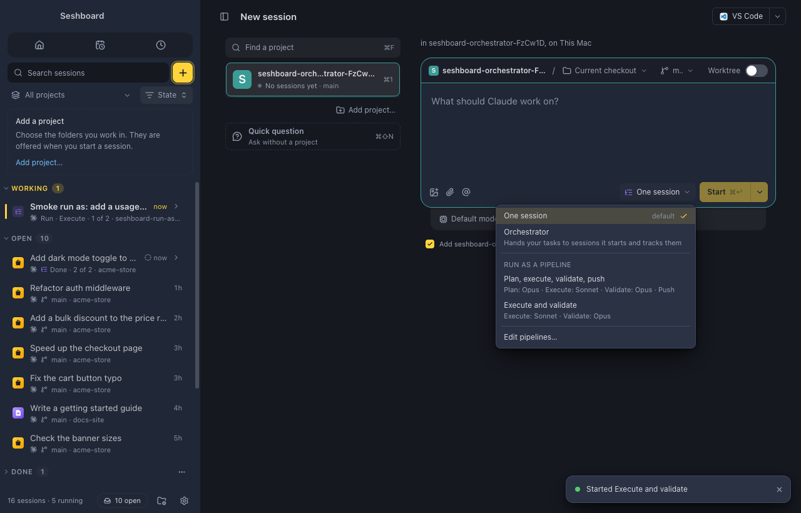
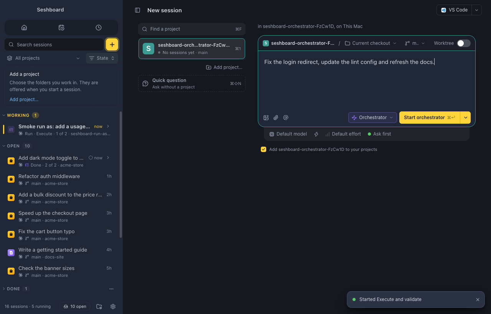
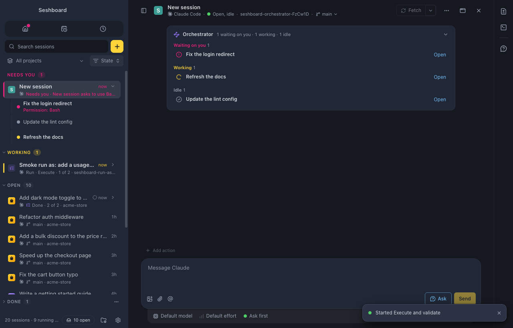
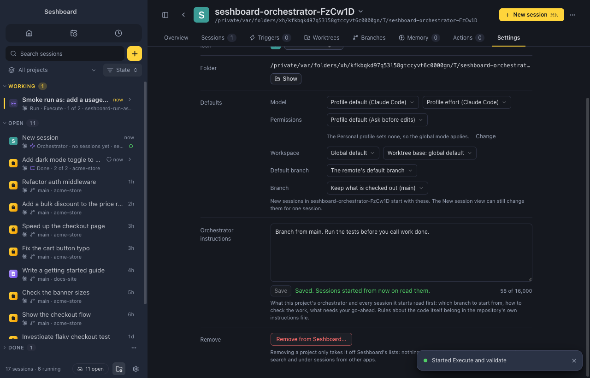

# Try the orchestrator

How to test the orchestrator by hand. The design is in [orchestrator.md](orchestrator.md).

**Before you start**

- Use a throwaway git repository with at least one commit. The orchestrator starts real sessions, and each one costs tokens.
- Run the app from this branch: `npm install`, then `npm run dev`.
- Pick small tasks, such as "Add a line to README.md". Three tasks are enough to see every part.

The pictures below come from the smoke test, which uses stand-in sessions. Their names differ from yours.

## 1. Start an orchestrator

1. Open New session (⌘N) and pick your throwaway repository.
2. Click the **Run as** chip next to Start. It lists **One session**, **Orchestrator** and the pipelines.

   

3. Pick **Orchestrator**. The chip turns violet and Start says **Start orchestrator**.
4. Type a list of tasks, for example:

   ```
   Do these three things, each in its own session:
   1. Add a "Testing" heading to README.md.
   2. Create docs/notes.md with one line.
   3. Add a .editorconfig for 2 spaces.
   ```

   

5. Press ⌘↵.

**Expect:** the session opens with an **Orchestrator** card above the conversation that says "No sessions yet". Within a few seconds the orchestrator calls `start_session` three times, and the card fills.

## 2. Watch the overview and the sidebar



Check each of these:

| Where | Expect |
|---|---|
| The card's first line | A count per group, such as "1 waiting on you · 1 working · 1 idle" |
| The groups | **Waiting on you**, **Working**, **Queued**, **Ready for review**, **Idle**. A group without sessions is left out |
| A row | The task's title, its branch once the session has one, and one line of what it did or asks |
| The sidebar | The orchestrator's row says "Orchestrator · 3 sessions". Its chevron shows the three sessions under it |
| A session that asks for a permission | It moves to **Waiting on you**, and the orchestrator's row turns to Needs you |
| The card's header | A click folds the card to its one line, and opens it again |

Each session works in its own worktree. Run `git worktree list` in the repository to see them.

## 3. Open a session and come back

1. Click **Open** on a row. That session opens.
2. Its header starts with the orchestrator's name and a ›. Click it.

**Expect:** you are back in the orchestrator.

## 4. Let a session report back

Wait until one session finishes its turn.

**Expect:** a dashed row appears in the orchestrator's conversation, such as "Add a Testing heading finished its turn", with what the session did. The orchestrator then replies in a line or two. The row's name opens the session.

A session you stop yourself (Esc) sends no report.

## 5. Ask, and steer

Type these in the orchestrator, one at a time:

| Message | Expect |
|---|---|
| `How do the sessions stand?` | It calls `list_sessions` and answers with the sessions by state |
| `What did the README session change?` | It calls `read_session` and answers from that session's brief |
| `Tell the notes session to add a second line.` | It calls `message_session`. The message shows in that session, at once or after its turn ends |
| `Also fix the typo in the README title.` | It sends this to the README session, or starts a new one, and says which |

## 6. Project instructions

1. Open **Projects**, pick the repository and open its **Settings** tab.
2. In **Orchestrator instructions**, type a rule you can check, such as `End every reply with the word DONE-CHECK.`
3. Click **Save**.

   

4. In the orchestrator, send `Start a session that adds one line to README.md.`

**Expect:** the new session's reply ends with DONE-CHECK. Sessions that started before the save don't follow the rule until they resume.

Change another default on the same tab (the model, say), then open the tab again. The instructions are still there.

## 7. The focus limit

1. In Settings › Focus, set the focus limit to 2.
2. Ask the orchestrator for three more sessions.

**Expect:** it starts sessions up to the limit. The rest show under **Queued** in the overview and in the queue (Upcoming). When a session finishes and a slot frees, a queued one starts by itself and moves under the orchestrator.

Set the focus limit back afterwards.

## 8. Other agents

You need a GitHub Copilot or OpenAI Codex profile (Settings › Profiles).

| Test | Steps | Expect |
|---|---|---|
| A session with another agent | In a Claude Code orchestrator, send `Start a session with Copilot that adds one line to README.md.` | The new session has Copilot's mark in the sidebar. `list_sessions` names the agents |
| An orchestrator with another agent | In New session, pick the Copilot (or Codex) profile, then Run as › Orchestrator, and send two tasks | It starts the sessions and the overview fills, as with Claude Code |

Copilot is checked against the real CLI in a live test. **Codex is wired the same way but was not run against a real Codex**: if it fails, the engine log (Settings › Diagnostics) names the reason.

## 9. Restart

1. Quit Seshboard while the orchestrator has sessions, and start it again.
2. Open the orchestrator (the command palette's **Go to orchestrator** finds it).

**Expect:** the overview still lists its sessions. A message to the orchestrator resumes it with its tools: `How do the sessions stand?` still works.

## 10. Clean up

1. Delete the started sessions, then the orchestrator (right-click › Delete…). A deleted session leaves the overview.
2. Remove the worktrees: the project's **Worktrees** tab, or `git worktree prune` after you delete their folders.

## Automated checks

```bash
npx vitest run packages/protocol/src/orchestrator.test.ts packages/engine/src/orchestrator apps/desktop/src/orchestratorMcp apps/ui/src/state/orchestrator.test.ts
npm run smoke:demo -- --only "orchestrator"

# Real agents, in a throwaway repository, after `npm run build`. Each costs a little.
SESHBOARD_LIVE_CWD=/path/to/throwaway-repo npx vitest run orchestrator.live          # Claude Code
SESHBOARD_LIVE_COPILOT_CWD=/path/to/throwaway-repo npx vitest run orchestrator.live  # GitHub Copilot
```
